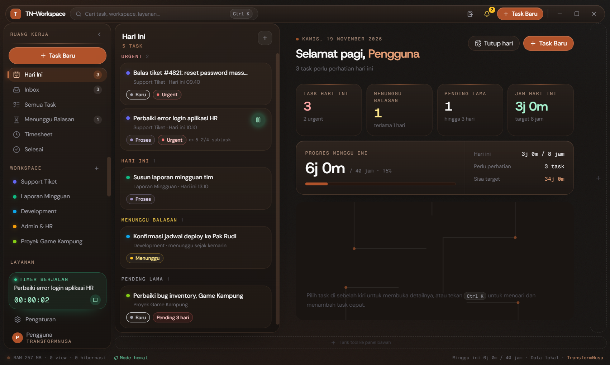

# TN-Workspace

**Superapp desktop berpusat task** — semua pekerjaan harian dalam satu jendela: task, chat, tiket, email, file proyek, catatan, dan waktu kerja.

Dibuat oleh **TransformNusa — Alip T. S.**



---

## Ringkasan

Pusat aplikasi ini adalah **Task**. Satu task menyimpan seluruh resource yang terkait — chat WhatsApp, tiket, email, file, folder proyek, catatan, dan waktu kerja — lalu membukanya dengan satu klik. Aplikasi berjalan lokal di Windows, tanpa server dan tanpa telemetri.

Cocok untuk pekerjaan yang berpindah-pindah antar layanan: setiap layanan dibuka sebagai *view* tertanam (WebContentsView) dengan sesi login terpisah, dan view yang tidak dipakai dihibernasi agar RAM tetap rendah.

## Fitur

**Task & hari kerja**
- Hari Ini: pengelompokan otomatis (urgent, hari ini, menunggu balasan, pending lama)
- Task dengan subtask, catatan (markdown), prioritas, tenggat, template & task berulang
- Timer manual per task (bisa beberapa task berjalan bersamaan), deteksi idle otomatis, resume note
- Penutup hari: ringkasan hari + sisa pekerjaan
- Timesheet mingguan, entri manual, draf laporan siap salin, penanda "sudah disalin"

**Tangkap cepat & inbox**
- Ctrl+Shift+N untuk menangkap isi clipboard menjadi item inbox atau task
- Inbox terpadu dengan status (baru, ditunda, sudah ditangani) dan filter sumber
- Pintasan global, pengingat terjadwal dengan notifikasi

**Layanan web tertanam**
- WhatsApp, Telegram, email, tiket, dan layanan lain sebagai view terpisah per profil
- Split view beberapa layanan berdampingan, tab, zoom, DevTools
- Mode hemat: hibernasi view yang tidak terlihat (batas jumlah view hidup)

**Tool**
- Catatan (scratchpad autosave, bisa di-dock ke panel bawah), Image Resizer (batch, PNG/JPG/WebP), Screenshot Editor (anotasi), File Manager, GridCraft
- Tool Manager: impor tool dari script/web/launcher, dock ke panel kanan atau bawah
- Contoh tool siap impor: `examples/tools/catatan-cepat` (tool.json + script + README belajar)
- Python portable untuk tool script

**Lainnya**
- Command palette (Ctrl+K) untuk semua aksi
- Pengaturan menyeluruh: umum, waktu kerja, pengingat, pintasan, performa, aplikasi & path, layanan web, tool, spreadsheet
- Tema gelap "ember glassy": kaca hangat, aksen terracotta, dan sirkuit dekoratif hanya di ruang kosong

## Tumpukan teknologi

| Bagian | Teknologi |
|---|---|
| Shell desktop | Electron 45 (jendela frameless) |
| Antarmuka | React 19 + TypeScript, Vite (electron-vite) |
| Gaya | Tailwind CSS 3, font DM Sans / Host Grotesk / Fragment Mono (dibundel lokal) |
| State | Zustand |
| Data | SQLite lokal (better-sqlite3) + migrasi berversi |
| Validasi | Zod |
| Ikon | lucide-react |

## Persyaratan

- Windows 10/11 (target utama; aplikasi memakai WebContentsView dan pintasan global)
- Node.js >= 22
- Python opsional (hanya untuk tool script — `npm run setup:python`)

## Menjalankan

```bash
npm run setup      # pasang dependensi + binary Electron
npm run dev        # mode pengembangan (hot reload)
```

Perintah lain:

```bash
npm run build       # build produksi ke out/
npm run start       # jalankan hasil build
npm run typecheck   # TypeScript untuk main + renderer
npm run measure     # self-test + gerbang RAM idle (< 300 MB)
npm run dist        # installer Windows (electron-builder, NSIS)
npm run setup:python
```

## Struktur proyek

```
src/
  main/        proses utama Electron: jendela, IPC, DB, view manager, tool runner, pengingat
  preload/     jembatan IPC (contextIsolation, sandbox) + preload untuk view pihak ketiga
  renderer/    antarmuka React: komponen, fitur, store Zustand, tema (index.css)
  shared/      tipe & kontrak yang dipakai main dan renderer
migrations/    migrasi SQLite berversi
scripts/       skrip bantu (setup Python portable)
docs/          dokumentasi produk & catatan pengembangan
MEMORY/        peta kode untuk agen (opsional dibaca manusia)
```

## Data & privasi

- Semua data tersimpan lokal: `%APPDATA%\alip-workspace\alip-workspace.db`
- Tidak ada server, tidak ada telemetri, tidak ada unggahan data
- Sesi login layanan web memakai sesi Electron Anda sendiri (bukan disimpan di repo)
- Aplikasi menolak semua permintaan izin (kamera, mikrofon, notifikasi web) secara default

## Verifikasi

| Perintah | Isi |
|---|---|
| `npm run typecheck` | TypeScript untuk konfigurasi main & renderer |
| `npm run measure` | 160 self-test end-to-end + gerbang RAM idle < 300 MB |
| `npm run measure:web` | ukur RAM dengan beberapa view web hidup |

## Pintasan

| Pintasan | Aksi |
|---|---|
| `Ctrl+K` | Command palette |
| `Ctrl+N` | Task baru |
| `Ctrl+Shift+N` | Tangkap cepat dari clipboard |

## Dokumentasi

- [docs/README.md](docs/README.md) — indeks dokumentasi
- [docs/SUPERAPP_BIBLE_v1.1.md](docs/SUPERAPP_BIBLE_v1.1.md) — visi produk & spesifikasi (dokumen sumber)
- [docs/fase-0.md](docs/fase-0.md) … [docs/fase-6.md](docs/fase-6.md) — catatan implementasi per fase

## Lisensi

[MIT](LICENSE) © 2026 TransformNusa — Alip T. S.

## Kredit

**TransformNusa — Alip T. S.**

Atribusi ini juga tampil di dalam aplikasi: status bar, sidebar, dan bagian bawah halaman Pengaturan. Lihat [CREDITS.md](CREDITS.md) untuk komponen pihak ketiga.
